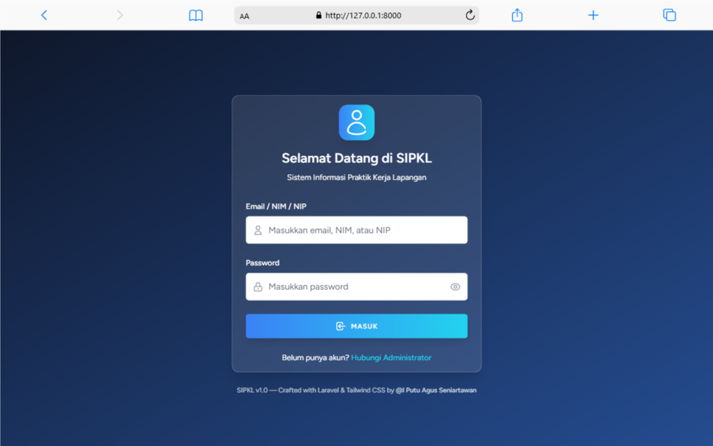
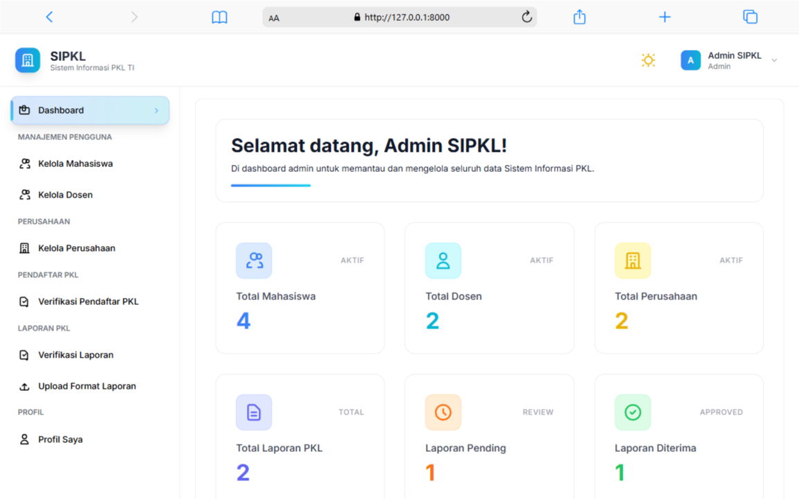
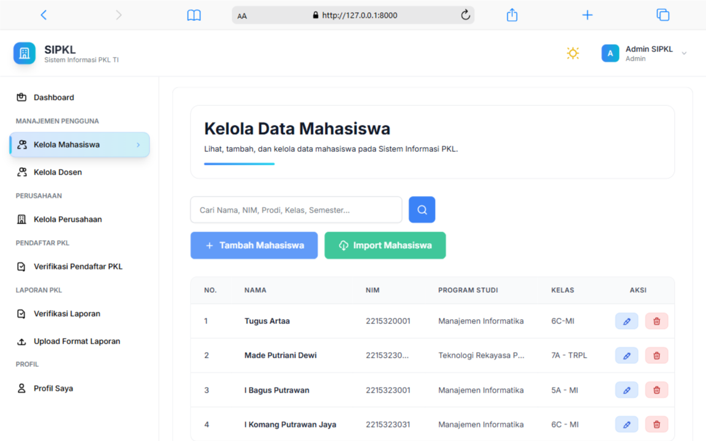
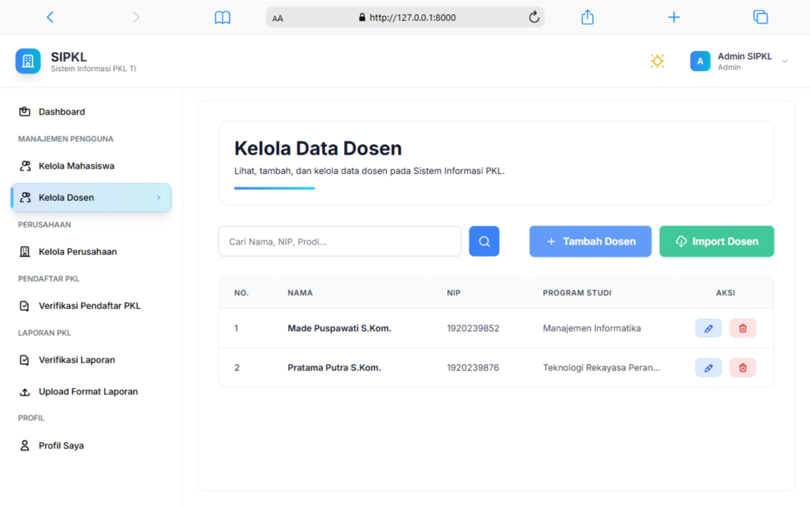
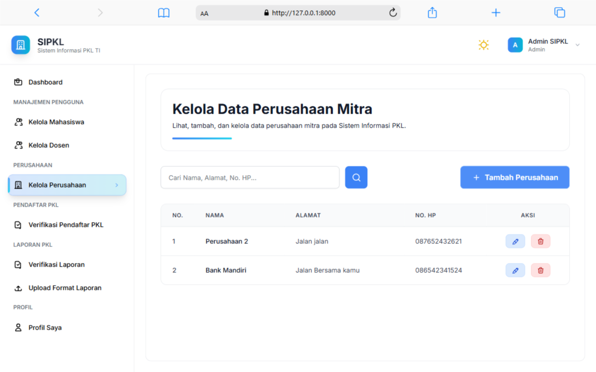
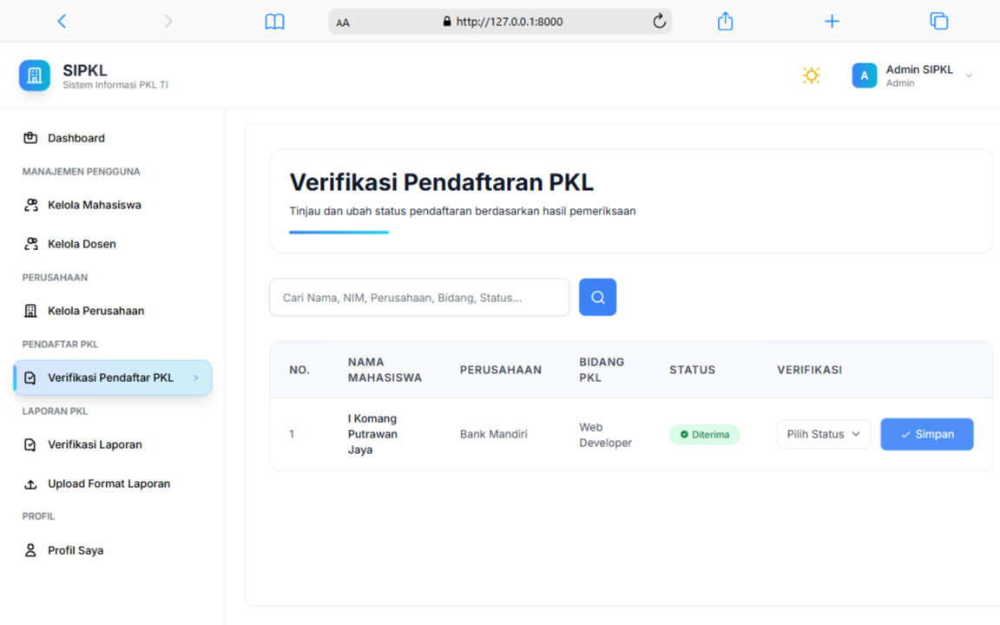
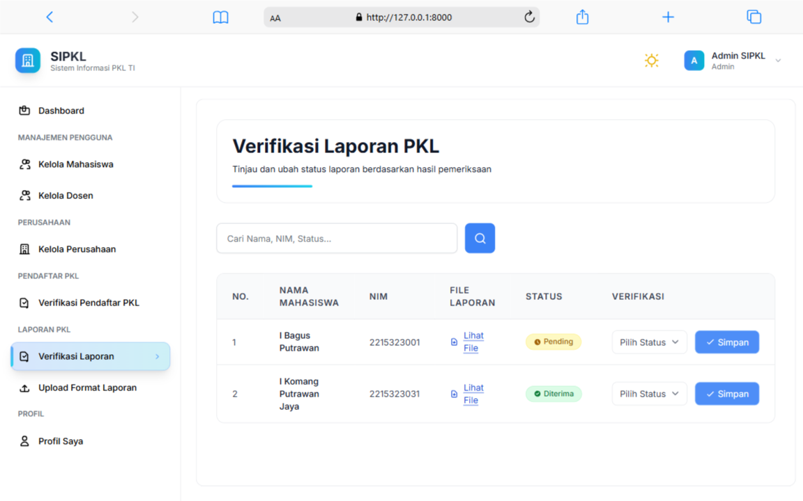
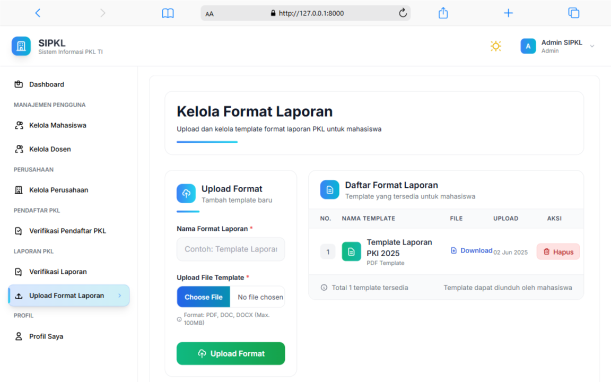
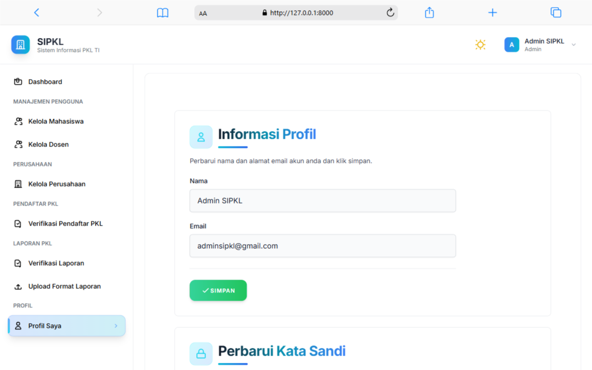

# 🎓 SIMPEL-5 (Sistem Informasi Praktik Kerja Lapangan)

**SIMPEL-5** adalah aplikasi web berbasis Laravel untuk mempermudah pengelolaan proses **Praktik Kerja Lapangan (PKL)** di lingkungan **Jurusan Kampus**. Sistem ini menyediakan fitur lengkap mulai dari pendaftaran PKL, pengajuan bimbingan, unggah laporan, hingga penilaian akhir oleh guru pembimbing.

> Dibuat sebagai proyek pribadi.

## 📌 Fitur Utama

Untuk semua roles:

- Login dengan NIM/NIP/Email
- Nama lengkap
- Email
- No Telepon
- Alamat
- Perbarui kata sandi

### 🔐 Otentikasi Role

- Admin
- Guru Pembimbing
- Siswa

### 🎛️ Admin

- Dashboard statistik
- Kelola data siswa dan guru (manual & import Excel)
- Kelola dan tambah perusahaan mitra
- Verifikasi pendaftaran dan terima laporan PKL
- Upload format laporan resmi

### 🧑‍🏫 Guru

- Lihat dan pantau daftar siswa pkl
- Lihat daftar instansi
- Input nilai PKL
- Analisis kesiapan kerja dengan KNN
- Training dataset dengan KNN (manual & import Excel (soon))

### 🎓 Siswa

- Pendaftaran PKL dan pantau status pendaftaran dengan guru pembimbing
- Lihat list perusahaan
- Tambah rekomendasi perusahaan
- Ajukan bimbingan PKL
- Upload laporan PKL
- Unduh format laporan PKL

## 🧩 Teknologi

- Laravel 11
- Laravel Breeze (auth)
- Tailwind CSS
- Vite
- MySQL

## Tampilan User Interface

### 🔑 Login

<table>
  <tr>
    <td></td>
  </tr>
</table>

### 🎛️ Admin

<table>
  <tr>
    <td></td>
    <td></td>
  </tr>
  <tr>
    <td></td>
    <td></td>
  </tr>
  <tr>
    <td></td>
    <td></td>
  </tr>
  <tr>
    <td></td>
    <td></td>
  </tr>
</table>

### 🎓 Siswa

<table>
  <tr>
    <td></td>
    <td></td>
  </tr>
  <tr>
    <td></td>
    <td></td>
  </tr>
  <tr>
    <td></td>
    <td></td>
  </tr>
  <tr>
    <td></td>
    <td></td>
  </tr>
</table>

### 🧑‍🏫 Guru

<table>
  <tr>
    <td></td>
    <td></td>
  </tr>
  <tr>
    <td></td>
    <td></td>
  </tr>
  <tr>
    <td></td>
    <td></td>
  </tr>
</table>
